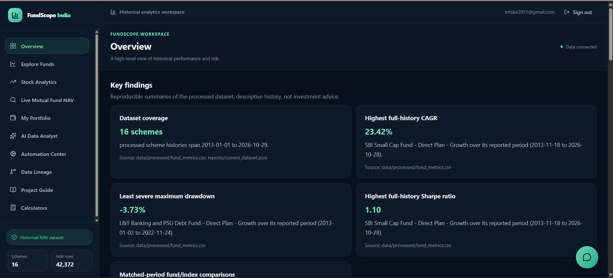
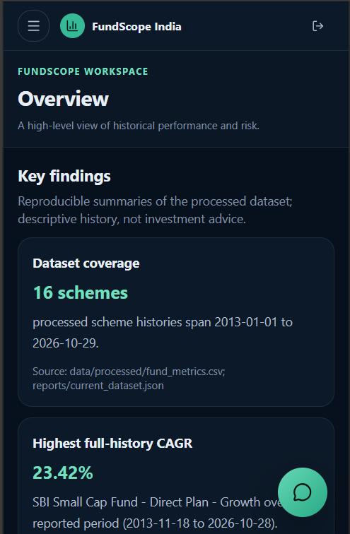
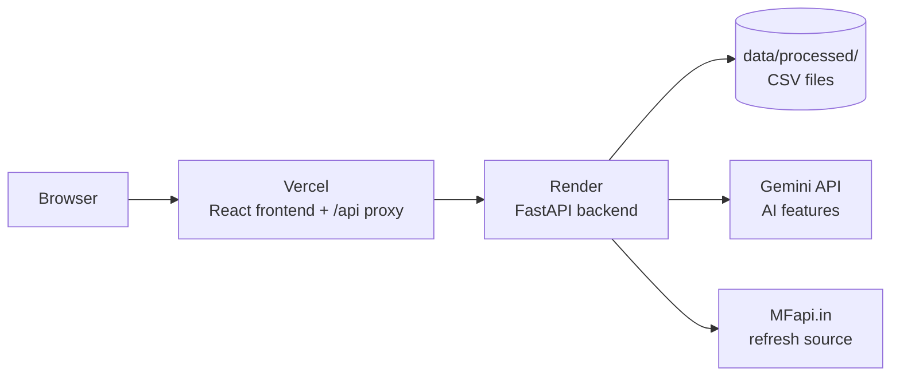

# FundScope India

Educational mutual-fund analytics for exploring historical Indian NAV data. Compare observed returns and risk, review performance over matched periods, and try illustrative calculators. It does not recommend funds or predict future performance.

**Live app:** https://fund-scope-india.vercel.app

## Screenshots

| Overview | Dashboard on mobile |
|---|---|
|  |  |

## Features

The dashboard has ten pages:

- **Overview:** historical performance, risk, and dataset findings
- **Explore Funds:** browse and compare mutual fund schemes
- **Stock Analytics:** inspect supported stock price history
- **Live Mutual Fund NAV:** search schemes and view available NAV observations
- **My Portfolio:** illustrative results from entered holdings
- **AI Data Analyst:** ask questions about available dataset metrics
- **Automation Center:** view and use data refresh controls
- **Data Lineage:** dataset provenance and source information
- **Project Guide:** the project and analytics guide
- **Calculators:** illustrative financial calculations

## Architecture



The frontend is served from Vercel. API requests go through the Vercel `/api` proxy to the FastAPI backend on Render, so the browser sees a single origin. The backend reads generated files from `data/processed/`. AI features use the Gemini API when configured, and refresh features use MFapi.in.

## Data

- **Schemes:** 16
- **NAV rows:** 42,372
- **Date range:** 2013-01-01 to 2026-10-29

Real-data catalogue is sourced through MFapi.in, a third-party aggregator, not the official AMFI site. The repository also contains a separately labelled synthetic demo dataset. Synthetic values are not market data.

Counts can change when data is refreshed.

## Metrics

The pipeline calculates for each scheme:

- Period return and CAGR
- Annualized volatility
- Maximum drawdown
- Sharpe, Sortino, and Calmar ratios
- Rolling and calendar-year returns

Metrics use each scheme's retained NAV observations. Gaps are not filled with synthetic data. Full formulas, annualization, risk-free-rate assumptions, and missing-day handling are in [docs/METHODOLOGY.md](docs/METHODOLOGY.md).

## Tech Stack

| Layer | Technology |
|---|---|
| Frontend | React, TypeScript, Vite, Tailwind CSS |
| Backend | FastAPI, Python, pandas |
| Auth | Google OAuth, Firebase email sign-in |
| AI | Google Gemini (with rule-based fallback) |
| Hosting | Vercel (frontend), Render (backend) |

## Challenges Solved

**Cross-site cookies.** Session cookies did not reach the backend from the Vercel domain. A Vercel `/api` proxy gives the browser a same-origin API path. Read-only dataset endpoints are public, and sensitive operations stay protected.

**Login redirect 404.** Google sign-in redirected to `/app`, which returned a 404 on a direct page load. A Vercel SPA rewrite serves the frontend entry point, and the client router handles `/app`.

**Free-tier sleep.** Render's free tier sleeps between requests. An external uptime monitor pings the health endpoint. A cold start can still delay the first request.

**Safe Browsing warning.** The backend domain was flagged by Google Safe Browsing. Routing the browser through the frontend domain reduces direct exposure, but domain reputation is handled separately.

## Running Locally

Run commands from the repository root unless noted.

**Set up Python**

```powershell
py -m venv .venv
.\.venv\Scripts\Activate.ps1
pip install -r requirements-dev.txt
```

macOS or Linux:

```bash
python3 -m venv .venv
source .venv/bin/activate
pip install -r requirements-dev.txt
```

**Build processed data**

```bash
python run_project.py
```

This writes CSV files to `data/processed/`. For the synthetic demo dataset, run `python run_project.py --source demo`.

**Start the backend**

```bash
python -m uvicorn backend.main:app --reload --port 8000
```

API docs: http://localhost:8000/docs

**Start the frontend**

```bash
cd frontend
npm install
npm run dev
```

Open http://localhost:5173. In development, Vite proxies `/api` requests to `http://localhost:8000`.

Optional sign-in and AI features need backend configuration. Do not put credentials in frontend files.

**Run tests**

```bash
python -m pytest -q tests
```

The suite includes hand-calculated checks for the core metrics.

## Limitations

- The backend runs on a free hosting tier and can sleep, so the first request may be slow.
- Data comes from a third-party aggregator and may be incomplete or delayed.
- Some features use illustrative inputs and are not connected to real holdings.

## Disclaimer

FundScope India is for educational analytics only and is not investment advice. Historical data may be incomplete or delayed, and past performance does not predict future results. Verify the data source and date coverage before interpreting any result.