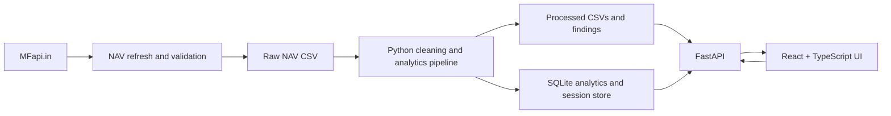

# FundScope India: Mutual Fund Performance & Risk Analytics

To add a GitHub Actions status badge, publish this project and replace the
owner/repository segment in the badge URL with its actual GitHub slug.

An end-to-end analytics project for Indian mutual funds. It covers:

- a Python data pipeline (validation, cleaning, metrics, SQLite output),
- a FastAPI backend that serves the analytics,
- a React + TypeScript frontend,
- SQL analysis queries and a Power BI guide.

> **Disclaimer:** This project is for educational analytics only. It is not investment advice. Historical performance does not predict future returns.

## Status

The four primary workspace areas are Overview, Fund Explorer, Calculators, and
Portfolio. Python tests/lint/type checks, frontend type/component/build checks,
and responsive Playwright checks pass in this environment. Docker and Compose
files are provided, but their image build is not verified because Docker is not
available here. See [the roadmap](./docs/roadmap.md) and [CHANGES.md](./CHANGES.md)
for verified scope and remaining limitations.

## Current data

The real-data refresh fetches **16 direct-plan growth schemes** from MFapi.in across small cap, large cap, mid cap, flexi cap, debt, and index categories, including SBI Small Cap Fund (scheme code 125497). MFapi.in is a third-party API, not the official AMFI site; availability, completeness, update timing, and reuse rights are not guaranteed. Run `run_nav_refresh.bat` (Windows) or `python -m src.data_sources.refresh_real_nav` from the project root to fetch/upsert the configured scheme set. Per-refresh row counts, duplicate keys, NAV jumps, and date gaps are appended to `reports/dq_results.jsonl`; unusual jumps are flagged, not removed.

Risk-free estimates and all return/risk formulas are documented in [METHODOLOGY.md](./METHODOLOGY.md). Sharpe and Sortino use approximate year-specific Indian 91-day Treasury-bill proxies; they do not use a flat 4% rate.

The repository also includes a small synthetic demo dataset (`data/raw/nav_history.csv`). It is labelled as synthetic everywhere it appears and must not be presented as real fund performance.

## Key findings

These findings are generated from the processed files by
[`src/key_findings.py`](./src/key_findings.py); the complete generated
comparisons and metadata are in
[`reports/key_findings.json`](./reports/key_findings.json). They describe the
current dataset snapshot, not recommendations. Scheme periods differ unless an
exact common-date comparison is stated.

- The processed catalogue contains **16 schemes**, with reported scheme
  histories spanning **2013-01-01 to 2026-10-29**.
- The highest full-history CAGR in the processed metrics is **23.42%** for
  SBI Small Cap Fund - Direct Plan - Growth (**2013-11-18 to 2026-10-28**).
- The least severe reported maximum drawdown is **-3.73%** for L&T Banking and
  PSU Debt Fund - Direct Plan - Growth (**2013-01-02 to 2022-11-24**).
- The highest full-history Sharpe ratio is **1.10** for SBI Small Cap Fund -
  Direct Plan - Growth (**2013-11-18 to 2026-10-28**).
- In **24 of 39** fund/index pairs with exact shared observations, the fund's
  period return exceeded its paired index fund; the median period-return
  difference was **22.83%**. Each pair has its own date window, and this is not
  an annualized or risk-adjusted result.

Recompute the output after rebuilding processed data with:

```bash
python -m src.key_findings
```

The script labels the findings as synthetic when the active dataset is the
synthetic demo set.

## What's new

This section reports dataset refresh metadata only, not product-release news.
`reports/current_dataset.json` records that the current NAV dataset was
processed at **2026-10-29 20:44 UTC**. The project does not publish product
release notes from unavailable Git history.

## Project structure

```text
FundScope-India/
├── backend/             FastAPI app (routes, auth, Gemini client)
├── frontend/            React + TypeScript + Vite app
├── src/                 Analytics, data pipeline, data-source fetchers
│   ├── analytics.py         cleaning and metric functions (pure, tested)
│   ├── pipeline.py          end-to-end run: clean -> metrics -> CSV + SQLite
│   ├── data_sources/        MFapi.in and stock data fetchers, daily refresh
│   └── portfolio/           portfolio calculations
├── data/raw/            input CSVs (real NAV file, synthetic demo, scheme metadata)
├── data/processed/      generated tables (cleaned NAV, metrics, monthly returns)
├── reports/             generated data-quality report, key findings, and summary
├── docs/                project roadmap and supporting documentation
├── assets/screenshots/  Playwright captures (synthetic test fixture data)
├── sql/                 SQLite star-schema migration and 18 analysis queries
├── notebooks/           exploratory analysis notebooks
├── powerbi/             Power BI dashboard guide (no .pbix included)
├── tests/               pytest suite
├── Dockerfile           FastAPI backend image
├── docker-compose.yml   Backend and built frontend services
├── CONTRIBUTING.md      contributor workflow and checks
├── .env.example         Docker Compose settings template
├── run_project.py       runs the data pipeline
├── run_nav_refresh.bat  daily NAV refresh for Windows Task Scheduler
├── secrets.example.toml template for local API keys
└── requirements.txt
```

## Architecture



## Responsive screenshots

The captures below show the actual running UI with clearly labelled synthetic
Playwright fixtures; they are not market data. The E2E suite recreates them at
all four viewport widths.

| Page | 360px | 768px | 1024px | 1440px |
|---|---|---|---|---|
| Landing | [View](assets/screenshots/landing-360.png) | [View](assets/screenshots/landing-768.png) | [View](assets/screenshots/landing-1024.png) | [View](assets/screenshots/landing-1440.png) |
| Overview | [View](assets/screenshots/overview-360.png) | [View](assets/screenshots/overview-768.png) | [View](assets/screenshots/overview-1024.png) | [View](assets/screenshots/overview-1440.png) |
| Fund Explorer | [View](assets/screenshots/fund-explorer-360.png) | [View](assets/screenshots/fund-explorer-768.png) | [View](assets/screenshots/fund-explorer-1024.png) | [View](assets/screenshots/fund-explorer-1440.png) |
| Calculators | [View](assets/screenshots/calculators-360.png) | [View](assets/screenshots/calculators-768.png) | [View](assets/screenshots/calculators-1024.png) | [View](assets/screenshots/calculators-1440.png) |
| Portfolio | [View](assets/screenshots/portfolio-360.png) | [View](assets/screenshots/portfolio-768.png) | [View](assets/screenshots/portfolio-1024.png) | [View](assets/screenshots/portfolio-1440.png) |

## Setup

### 1. Python environment

**Windows (PowerShell):**

```powershell
py -m venv .venv
.\.venv\Scripts\Activate.ps1
pip install -r requirements-dev.txt
```

**macOS / Linux:**

```bash
python3 -m venv .venv
source .venv/bin/activate
pip install -r requirements-dev.txt
```

### 2. Local secrets

```bash
cp secrets.example.toml secrets.toml      # Windows: copy secrets.example.toml secrets.toml
```

Fill in your own values in `secrets.toml`. This file is git-ignored. Never commit real keys. Gemini is optional; the AI routes can use the configured provider and fall back to local/rule-based analysis. Google or email sign-in needs Firebase and OAuth values. The pipeline and analytics work without them.

### 3. Run the data pipeline

```bash
python run_project.py                 # real multi-scheme data when refreshed (default)
python run_project.py --source demo   # synthetic demo data
```

This writes `data/processed/*.csv`, `reports/*`, and `fundscope.db`. Real runs use the multi-scheme refresh output when present, and retain the original SBI series as a compatibility fallback.

### 4. Run the app

Open two terminals from the project root.

**Terminal 1: backend**

```bash
python -m uvicorn backend.main:app --reload --port 8000
```

API docs: http://localhost:8000/docs

**Terminal 2: frontend**

```bash
cd frontend
npm install
npm run dev
```

Open http://localhost:5173.

The frontend API base defaults to the Vite `/api` proxy. See `frontend/.env.example` and `frontend/README.md` to configure a deployed API origin. Configure the backend with `CORS_ORIGINS` as a comma-separated list of trusted frontend origins, `FRONTEND_ORIGIN` as the OAuth return origin, and `BACKEND_ORIGIN` as the API origin used for the Google callback URL. The default CORS origin is `http://localhost:5173`.

Set `FUNDSCOPE_ENV=production` to enable `Secure` session cookies; local development keeps cookies usable over HTTP. Cookies are HttpOnly, SameSite=Lax, and expire after seven days. Admin-only pipeline operations require an `admin_emails` list under `[auth]` in `secrets.toml`; the example defaults to an empty list. Sessions and one-time Google OAuth state are persisted in the project's `fundscope.db`.

### Docker Compose

Copy `secrets.example.toml` to the ignored `secrets.toml` and fill in valid
Firebase and OAuth settings, then copy `.env.example` to `.env`. From the
project root, build and start both services with:

```bash
docker compose up --build
```

Open http://localhost:8080. The frontend image serves the production Vite build
and proxies `/api` to FastAPI. The SQLite session store persists in a named
volume. `secrets.toml` is mounted read-only at runtime and excluded from the
image build context. Gemini is optional. Configure HTTPS and production cookie
settings before exposing the services publicly.

## Daily NAV refresh

**Windows:** Open Task Scheduler, create a daily task, and point it to `run_nav_refresh.bat`. The script runs from its own folder and logs to `logs/nav_refresh.log`.

The refresh fetches all configured schemes concurrently, validates the returned NAVs, upserts on `(scheme_code, date)`, backs up the existing CSV, and rebuilds the outputs. If any scheme fetch or pipeline run fails, the existing dataset is retained and the refresh failure is recorded in the quality log.

## API overview

| Endpoint | Purpose |
|---|---|
| `GET /api/data` | Metrics, NAV series, monthly returns, sourced findings, matched-date index comparisons, and dataset metadata |
| `GET /api/status` | Dataset status and quality summary |
| `POST /api/pipeline/run` | Re-run the pipeline |
| `POST /api/pipeline/refresh-nav` | Fetch and merge the latest NAV |
| `GET /api/mf/search`, `GET /api/mf/nav` | Look up Indian mutual fund schemes |
| `GET /api/stocks/history` | Stock price history (via yfinance) |
| `POST /api/portfolio/calculate` | Portfolio gain and loss |
| `POST /api/ai/chat`, `GET /api/ai/insights` | AI analyst (Gemini, grounded on project data) |
| `GET /api/health` | Health check |

Generated files also include `rolling_returns.csv` and `calendar_year_returns.csv`; `fund_metrics.csv` includes Sharpe, Sortino, and Calmar ratios.

All application data, AI, download, and account logout routes require a valid session cookie. Pipeline run and NAV refresh operations additionally require an email listed in `[auth].admin_emails`. `/api/auth/session` remains public and returns a null user when signed out; login, signup, reset, and Google OAuth routes are public, with the OAuth callback validating one-time state bound to a short-lived HttpOnly browser cookie.

## Metric definitions

- **Period return:** ending NAV / starting NAV − 1.
- **CAGR:** `(ending NAV / starting NAV) ** (365.25 / elapsed calendar days) − 1`.
- **Annualized volatility:** standard deviation of daily returns × √252.
- **Maximum drawdown:** minimum of `NAV / running peak NAV − 1`.
- **Sharpe ratio:** mean daily excess return / sample standard deviation of daily returns × √252, using an approximate year-specific Indian 91-day T-bill proxy.
- **Sortino ratio:** mean daily excess return / downside deviation × √252.
- **Calmar ratio:** CAGR / absolute maximum drawdown.
- **Rolling returns:** annualized NAV growth over one, three, or five calendar years, using the last observation on or before each anniversary.
- **Calendar-year return:** current year's last observed NAV / prior calendar year's last observed NAV − 1.

See [METHODOLOGY.md](./METHODOLOGY.md) for definitions, yield proxies, source limitations, and omitted costs/cash flows.

## Tests

Install the development tools and run Python lint, type, and test checks:

```bash
python -m pip install -r requirements-dev.txt
python -m ruff check src backend
python -m mypy src backend
python -m pytest -q tests
```

Run frontend component tests, type-checking, production build, and the mocked
browser authentication and responsive-page checks:

```bash
cd frontend
npm ci
npx tsc --noEmit -p tsconfig.app.json
npx vitest run
npm run build
npx playwright install chromium
npx playwright test
```

The responsive Playwright suite writes the screenshot gallery to
`assets/screenshots/` using synthetic-labelled fixtures.

## Known limitations

- Admin emails must be configured before pipeline operations are available; an empty admin list denies all pipeline requests.
- Use HTTPS in production with `FUNDSCOPE_ENV=production`; ensure `CORS_ORIGINS`, `FRONTEND_ORIGIN`, and `BACKEND_ORIGIN` match the deployed hosts.
- 91-day Treasury-bill rates are annual rounded proxies; see `METHODOLOGY.md` for source and limitations.
- The scheme catalogue has 16 schemes, but category labels and data coverage should be checked against provider metadata before formal comparisons.
- Portfolio calculations use manually entered values and are not persisted to a user account.
- No Power BI `.pbix` file is included; the repository contains a build guide.
- Metrics are historical descriptive statistics, not predictions.

Set a fresh `GEMINI_API_KEY` in the backend process environment to configure the chat provider without storing its key in source control; `GEMINI_MODEL` optionally overrides the model name. Alternatively, configure `[gemini].api_key` in the ignored local `secrets.toml`. Never put provider keys in frontend code or tracked files.

## Power BI

Power BI Desktop is a separate Microsoft application. The pipeline applies
`sql/schema.sql` to create the `dim_fund`, `dim_date`, `fact_nav`, and
`fact_metrics` star schema and the `fund_performance_summary`,
`category_comparison`, `top_bottom_performers`, and `data_quality_status`
views. See [powerbi/DASHBOARD_GUIDE.md](./powerbi/DASHBOARD_GUIDE.md) for
SQLite ODBC/CSV setup, the four-page report layout, and copy-ready DAX KPI
measures. The separate documented queries are in [`sql/analysis/`](./sql/analysis/).
