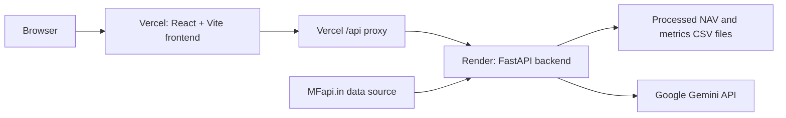

# FundScope India

FundScope India is an educational mutual-fund analytics project for exploring historical NAV data.

Live frontend: [https://fund-scope-india.vercel.app](https://fund-scope-india.vercel.app)

## Screenshots

Add current screenshots to the paths below.

These are placeholders; the images should be added by the author.

| Page | Screenshot |
|---|---|
| Overview | `docs/screenshots/overview.png` |
| Dashboard on mobile | `docs/screenshots/dashboard-mobile.png` |

Screenshots should represent the current application and should not imply
that illustrative examples are actual fund performance.

## Architecture



The browser loads the frontend from Vercel. Frontend API requests use the
Vercel `/api` proxy to reach FastAPI on Render. The backend reads the generated
files in `data/processed/`; configured refresh and AI features can use the
external data provider and Gemini API.

## Features

The dashboard sidebar contains the following pages:

- **Overview** — review fund performance, risk, and dataset findings.
- **Explore Funds** — browse and compare mutual fund schemes.
- **Stock Analytics** — inspect supported stock price history.
- **Live Mutual Fund NAV** — search schemes and view available NAV observations.
- **My Portfolio** — calculate illustrative results from entered holdings.
- **AI Data Analyst** — ask questions about available dataset metrics.
- **Automation Center** — view and use available data refresh controls.
- **Data Lineage** — inspect dataset provenance and source information.
- **Project Guide** — read the project and analytics guide.
- **Calculators** — try illustrative financial calculations.

The current processed NAV snapshot contains **16 schemes** and **42,372 NAV
rows**, from **2013-01-01** through **2026-10-29**. Counts and coverage describe
the files in this repository and can change when data is refreshed.

The real-data catalogue is sourced through MFapi.in, a third-party aggregator
and not the official AMFI site. The project also contains a separately
labelled synthetic demo dataset; synthetic values are not market data.

## Metrics and methodology

The pipeline calculates period return, CAGR, annualized volatility, maximum
drawdown, Sharpe, Sortino, and Calmar ratios, alongside rolling and
calendar-year returns.

Metrics are calculated separately for each scheme using its retained NAV
observations. Scheme history windows may differ, and gaps are not filled with
synthetic observations.

See [docs/METHODOLOGY.md](docs/METHODOLOGY.md) for formulas, annualization,
risk-free-rate assumptions, missing-day handling, and data coverage.

## Challenges solved

Cross-site session cookies between Vercel and Render complicated frontend
dataset access. The Vercel `/api` proxy provides a same-origin API path, and
read-only dataset endpoints can be accessed without a session; sensitive
operations remain protected.

Google sign-in returned users to `/app`, which could produce a Vercel 404 on a
direct page load. The Vercel SPA rewrite serves the frontend entry point, and
the client router sends `/app` to the Overview page.

The Render free tier can sleep between requests. An external uptime monitor
periodically checks the backend; the free tier may still sleep, and a cold
start can delay the first request.

A Google Safe Browsing warning was reported for the backend domain. Domain
reputation review is separate from application routing, and the current
browser status should be checked when accessing the service.

## Running locally

Run commands from the repository root unless a command changes directories.

### Prepare Python

The following Windows PowerShell commands are from the existing project setup:

```powershell
py -m venv .venv
.\.venv\Scripts\Activate.ps1
pip install -r requirements-dev.txt
```

On macOS or Linux, the documented environment commands are:

```bash
python3 -m venv .venv
source .venv/bin/activate
pip install -r requirements-dev.txt
```

### Build processed data

Run the pipeline from the repository root:

```bash
python run_project.py
```

The project also documents this command for the synthetic demo dataset:

```bash
python run_project.py --source demo
```

The pipeline writes generated CSV files under `data/processed/`.

### Start the backend

In a terminal at the repository root, run:

```bash
python -m uvicorn backend.main:app --reload --port 8000
```

The FastAPI documentation is available at:

```text
http://localhost:8000/docs
```

### Start the frontend

In a second terminal, run the existing frontend commands:

```bash
cd frontend
npm install
npm run dev
```

Open the Vite development server at:

```text
http://localhost:5173
```

During local development, Vite proxies `/api` requests to
`http://localhost:8000`. Optional sign-in and AI integrations require their
respective backend configuration; do not put credentials in frontend files.

### Run the Python tests

From the repository root, the project test command is:

```bash
python -m pytest -q tests
```

The hand-calculated metric test is included in this suite.

## Disclaimer

FundScope India is for educational analytics only and is not investment
advice. Historical data may be incomplete or delayed, and past performance
does not predict future results. Verify data source and date coverage before
interpreting any result.
